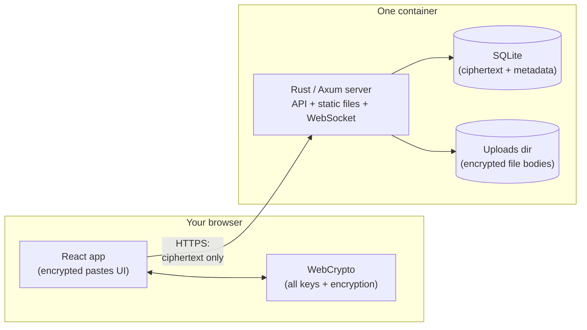
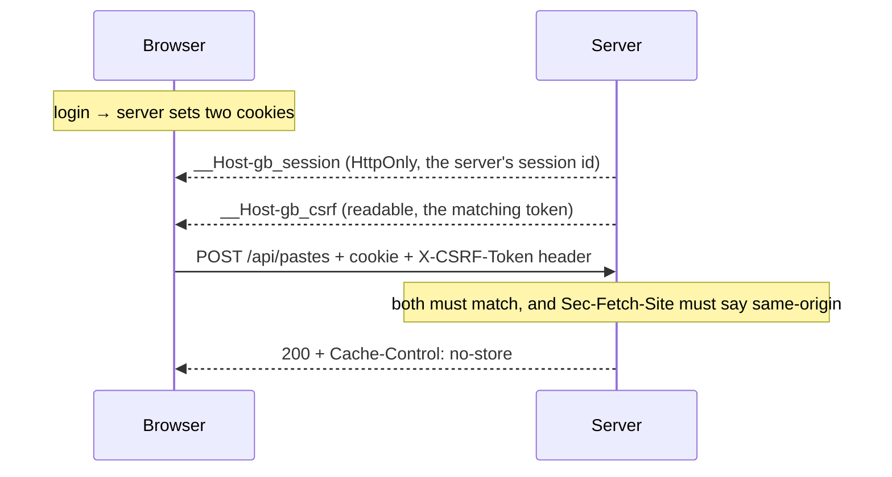
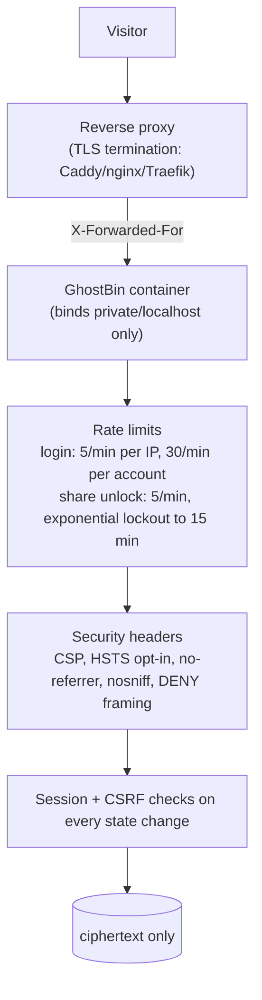

# Architecture

GhostBin is one Rust binary and one browser app. There is no database server, no queue, no sidecar: the whole backend is a single process that serves both the API and the compiled frontend.

---

## 1. The big picture

- **The binary is the whole backend**: it serves the compiled React app from `dist/`, the JSON API under `/api`, and the events WebSocket, all on one port.
- **SQLite** stores rows of ciphertext plus routing metadata (ids, salts, timestamps, burn rules). It lives in a single file inside the data volume.
- **Attachments** are encrypted bodies on disk; the database only keeps their ids, sizes, and encrypted metadata.
- **The browser does all crypto.** The server's job is storage, routing, rate limiting, and enforcing burns. It never holds a usable key (see [e2ee.md](e2ee.md)).

## 2. A request's life

Every API call travels with the same two-piece ID:

- **Session cookie**: HttpOnly, so page JavaScript can't exfiltrate it; only the browser attaches it.
- **CSRF token**: a cookie *and* a header the app must echo back; another site can't forge requests because it can't read the cookie to set the header.
- **`no-store` everywhere**: no proxy or browser ever caches a paste response.

## 3. What the API exposes

| Route | Purpose |
|---|---|
| `POST /auth/setup` | One-time server claim (passphrase set, optional setup token) |
| `POST /auth/login` / `logout` | Login with the derived auth key; session lifecycle |
| `POST /auth/change-passphrase` | Re-wraps the vault key, kills other sessions |
| `GET /pastes`, `POST /pastes` | List (paginated) / create encrypted pastes |
| `GET/PUT/DELETE /pastes/{id}` | Read / edit / delete one paste |
| `POST /files`, `GET /files/{id}` | Upload / download encrypted attachments (quota-checked) |
| `GET/POST/DELETE /pastes/{id}/share` | Create / inspect / revoke shares |
| `GET /shares/{id}/params` | Public share parameters (salt, pinned Argon2 settings) |
| `POST /shares/{id}/challenge` | Nonce challenge for the guest proof |
| `POST /shares/{id}/unlock` | Verify proof → wrapped paste key |
| `POST /shares/{id}/view` | Consume one unlock; enforces unlock-count burns |
| `GET /events` | WebSocket for live-update notifications |
| `GET /api/params` (unauth) | Public config: size limits, setup state |

Owner routes require the session; guest share routes are the four under `/shares/{id}`, and only `params`/`challenge`/`unlock` are reachable without login.

## 4. Defense in depth

- The proxy is the public face; the app itself should never be exposed raw. `TRUSTED_PROXIES` tells the server which proxy IPs to believe when reading the client IP for rate limiting. Any other `X-Forwarded-For` is ignored, so visitors cannot spoof their way past a limit.
- `SETUP_TOKEN` protects the one-time claim of a fresh instance, so a scanner that finds the server before you do can't take it over.
- Uploads are streamed to disk with size limits enforced per file and per paste, checked inside the insert transaction so concurrent uploads can't race past a quota.

## 5. Simplicity trade-offs

Single binary + SQLite + in-memory state is chosen on purpose:

- ✅ one container, one volume, near-zero ops, trivially fast for one user
- ❌ no horizontal scaling: a second instance would have separate rate-limit buckets and separate event buses
- ❌ backups are "snapshot the SQLite file + the uploads dir" (`scripts/backup.sh` does this, online-safe)

If you ever outgrow that, the data model (ciphertext in SQLite) does not change; only the state that is currently in memory would.
