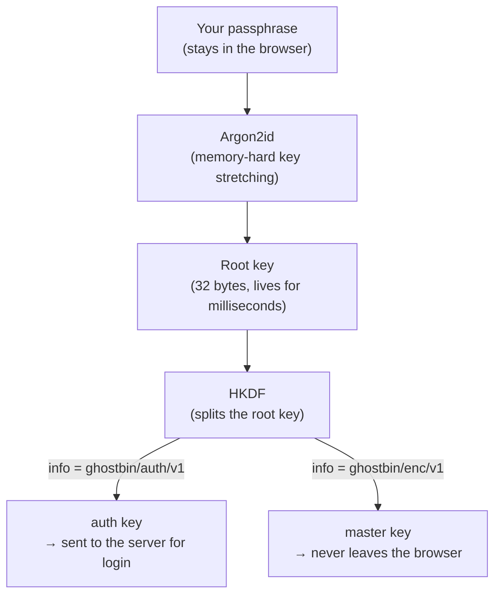
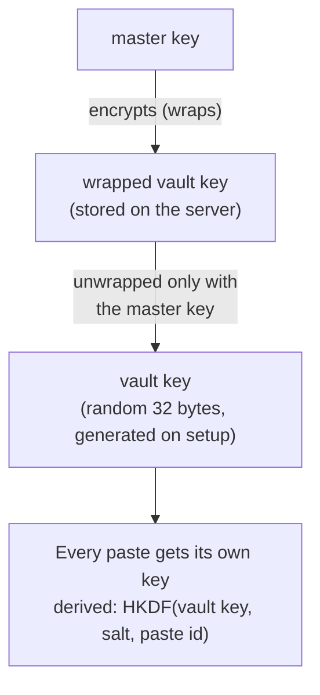
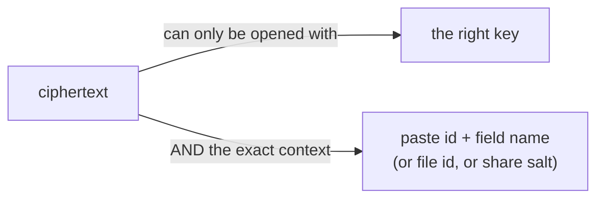
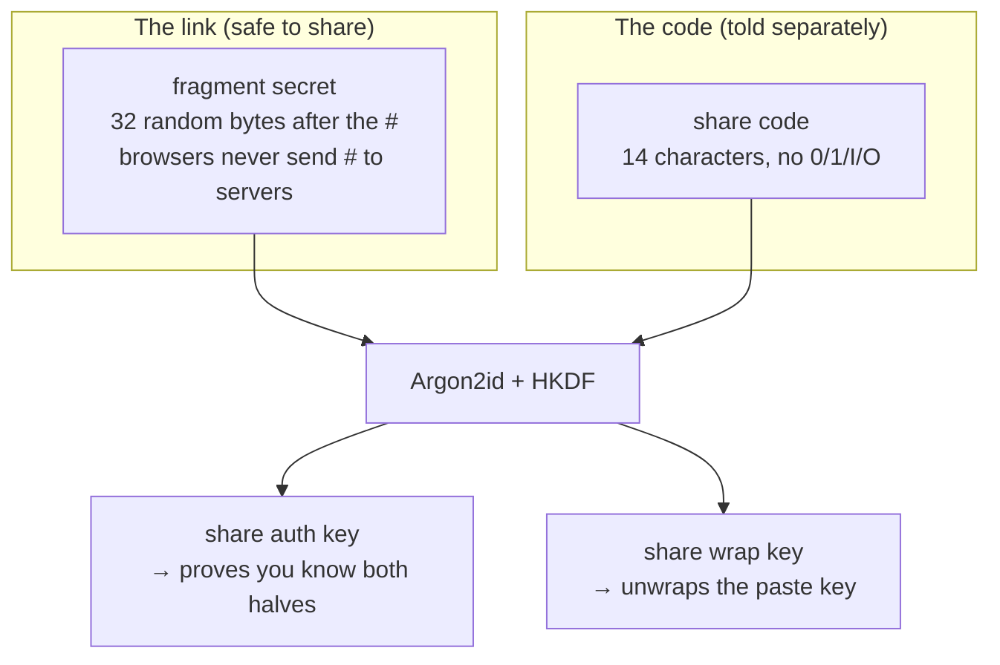
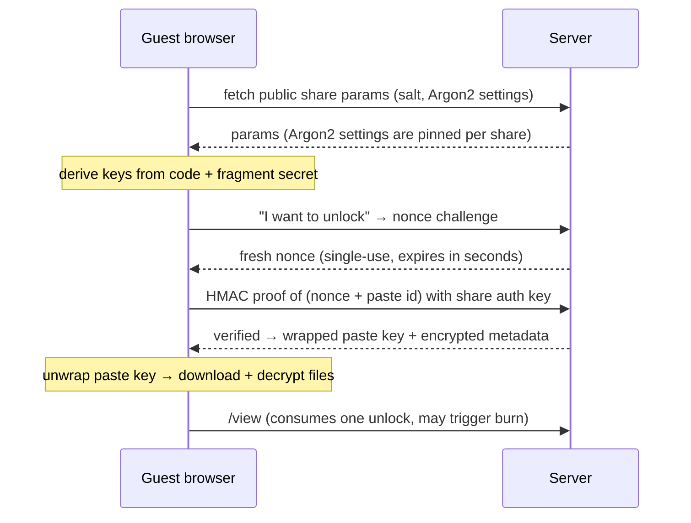

# How the end-to-end encryption works

The server stores only ciphertext. It cannot decrypt anything: every usable key exists solely in the browser, derived from a passphrase that is never sent to it. This page walks through how that is structured, with diagrams.

---

## 1. Your passphrase becomes two different keys

When you set up the server (or log in), the browser stretches your passphrase with **Argon2id**, which is intentionally slow (~90 ms) so brute-force guessing stays expensive. This protects the derived keys even if stored ciphertext is later stolen. The stretched result (the "root key") is immediately split by **HKDF** into two unrelated keys:

- **auth key**: the only thing that crosses the network. The server stores just an HMAC *verifier* of it (never the key itself) and checks every login against it.
- **master key**: used purely inside the browser to encrypt. The server never sees it, so even a full server compromise does not reveal it.

Because both keys come from the same passphrase, you never manage "a password *and* a key"; the passphrase is the whole identity.

## 2. The vault key: one random key that unlocks all your pastes

On setup, the browser generates a random **vault key**. Every paste you create gets its *own* key, derived from the vault key plus a per-paste salt, so no two pastes share a key. The vault key itself is encrypted ("wrapped") with the master key and stored on the server. The result:

- the server holds the wrapped vault key but cannot unwrap it,
- you can change your passphrase by re-wrapping the same vault key with a new master key; all pastes keep working.

**Staying unlocked without saving your passphrase.** If you allow it, the browser caches the vault key in IndexedDB as a *non-extractable* handle: JavaScript can use it to derive paste keys, but cannot read the raw bytes out of the WebCrypto boundary. The cache carries two self-checks:

- a **canary**: an HMAC over a fixed label, keyed by the handle itself. A mismatch on load means the record is corrupt or tampered with, and it is discarded.
- a **stamp**: a hash of the server's current wrapped vault key. Any re-wrap (passphrase change, reset) produces a new stamp, so a stale cached key from an older vault is rejected.

With no cache, or a rejected cache, you just type the passphrase again. Nothing was ever stored that could decrypt without it.

## 3. What the server sees (and never sees)

| | Stored on the server | Meaning |
|---|---|---|
| ✅ | HMAC verifier of your auth key | Can check logins, cannot recover the key |
| ✅ | Wrapped vault key | Ciphertext of the vault key; unusable without the master key |
| ✅ | Encrypted titles, content, file metadata, file bodies | Random-looking bytes |
| ✅ | Paste ids, salts, timestamps, sizes, burn rules | The *shape* of your data, not its content |
| ❌ | Your passphrase, master key, vault key, paste keys | Derived/generated in the browser only |

Limitation: end-to-end encryption hides *content*, not *behavior*. The server can still see when you connect, how much you store, and how often pastes are fetched. It cannot see what any of it says.

## 4. Every ciphertext is bound to its purpose (AAD)

Every encryption call attaches **additional authenticated data (AAD)**: a label like `ghostbin/paste/v1|<paste-id>|title`. Decryption fails unless the key *and* the exact label match. This makes it impossible to reuse a ciphertext in a different context: a ciphertext created for one paste's title cannot be presented as another paste's content, or as a different paste's file, even with the correct key.

## 5. Sharing: two half-secrets instead of one

A share link is safe to paste into a chat because it is only **half** of what's needed:

- The **fragment secret** rides in the URL fragment (`#...`). Browsers never send fragments to servers, so the server itself cannot read that half.
- The **code** is short and human-typeable, so it's the part you might read over the phone. It never travels inside the link.

The server stores only an HMAC verifier of the combined auth key, so even it cannot unlock the share without both halves.

**Unlocking looks like this:**

The **nonce challenge** stops replay attacks: a captured proof is worthless because each proof must be over a fresh nonce the server issued seconds earlier. The pinned **Argon2 settings per share** stop a malicious server from quietly weakening the guest's key derivation.

## 6. The rules that make all of this hold

- The passphrase is never transmitted, logged, or stored anywhere.
- Raw key bytes are zeroed after use; key objects are non-extractable.
- Encryption is AES-256-GCM with a fresh random nonce per operation.
- Changing your passphrase re-wraps the vault key and revokes all other sessions.
- **There is no recovery.** The server cannot reset a forgotten passphrase; it has nothing to reset it with. A lost passphrase means the stored data is permanently unreadable.
