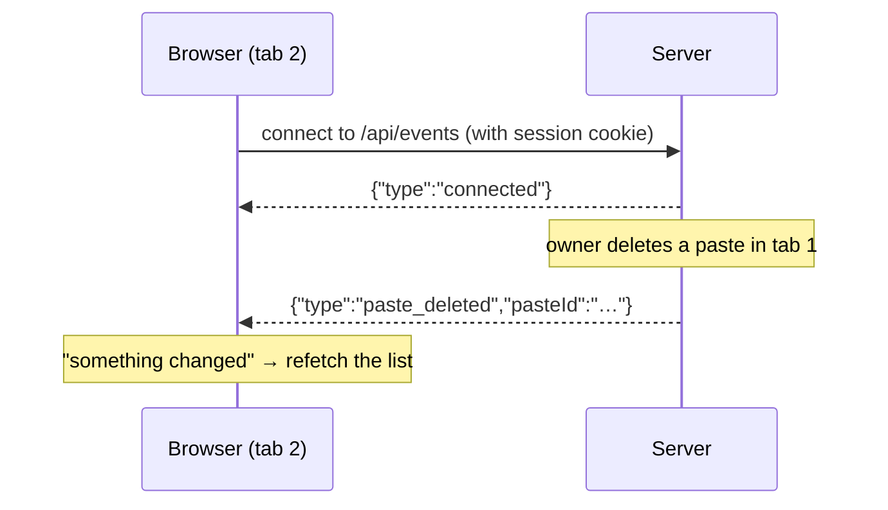
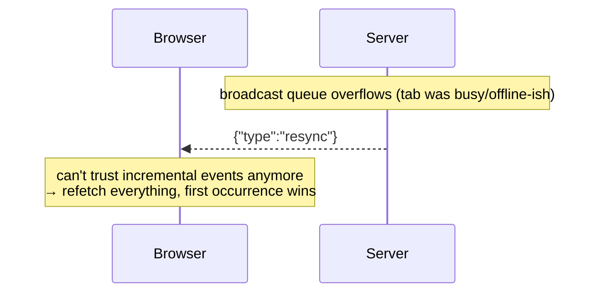
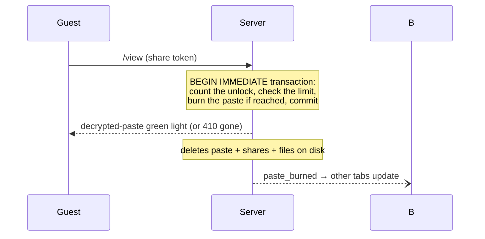

# How live updates (and burns) work

GhostBin keeps every open tab in sync without polling, and the sync channel never carries paste contents. Sync messages say *that* something changed, never *what*.

---

## 1. A notification-only WebSocket

After you unlock the vault, the app opens one WebSocket to `/api/events`. Every state-changing action (create, edit, pin, delete, share, burn) makes the server broadcast a small JSON note like `paste_updated` or `paste_deleted` to all connected tabs.

The messages carry **no paste content**: only the event kind and the paste id. There is nothing to leak, because the tabs don't need the content: they already hold the keys, so they re-fetch and decrypt the changed data themselves.

## 2. When a tab falls behind: `resync`

The broadcast queue holds 100 events. If a tab can't keep up (laptop asleep, busy main thread), the server won't replay history; it sends a single `resync` signal meaning "your view may be stale, re-fetch from scratch." The Home list then walks *every* page of the list (not just the first), deduplicating as it goes, so even pastes beyond page five come back correct.

The connection also survives network drops on its own: the client reconnects with a growing delay (1 s → 30 s cap) and the server re-checks your session every 30 seconds, closing the socket the moment you log out elsewhere.

## 3. How pastes burn

"Burn" is GhostBin's word for a paste deleting itself. Three triggers, all enforced server-side (the server deletes the row, its shares, and the encrypted file bodies on disk):

| Trigger | Rule | How it fires |
|---|---|---|
| **Time** | 1 minute – 30 days | Checked on every access + a sweep every 60 seconds, so expired pastes vanish even with no visitors |
| **Unlock count** | after N share unlocks | Evaluated *inside* the unlock-counting transaction, so two guests unlocking the "last" view simultaneously can never both get through |
| **Burned by owner** | manual delete | Immediate |

The atomic transaction is the important part: counting the unlock and (maybe) burning the paste happen as one indivisible step, so an unlock-count burn is exact even under concurrency.

Guests should know one ordering rule: attachments are downloaded *before* the `/view` call that consumes an unlock. The paste keys needed for those downloads only exist after a successful unlock, so the complete encrypted package is fetched before the "one look" is spent.

## 4. Trade-offs

- Live updates are **in-memory** on the server. That is instant and fits the single-instance design, but events do not survive a restart (clients re-fetch on reconnect anyway), and multiple load-balanced instances would not share events.
- A stale tab always self-heals: any next event, a `resync`, or plain navigation triggers a full re-fetch, so the worst case is data a few seconds old, never wrong data presented as fresh.
